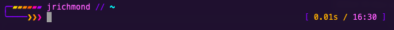

# Synthwave

A two-line Oh My Zsh theme with sunset stripes, orange-to-magenta prompt arrows, a violet frame, and a bright cyan path.



## Features

- Git branch with a cyan `○` for a clean worktree or an orange `●` for changes.
- Current directory, shortened to the last three path components.
- Username, plus hostname in SSH sessions.
- Active Python virtual environment inside the top line, as `[venv: virtual-env-name]`.
- Last command's elapsed time in seconds, beside a 24-hour clock.
- Failed command exit codes and a red leading prompt arrow.
- Background job count when jobs are present.
- Optional whole-terminal background color request.

The theme uses the 256-color palette and standard Unicode characters. No Nerd Font or Powerline font is required.

## Install

Requires Zsh, [Oh My Zsh](https://ohmyz.sh/), and a terminal with 256-color support, such as macOS Terminal, iTerm2, Windows Terminal (with Zsh running in WSL), GNOME Terminal, Konsole, Alacritty, kitty, or Ghostty. Git is needed for repository information.

Download the theme file into your Oh My Zsh custom themes directory:

```zsh
mkdir -p "${ZSH_CUSTOM:-$HOME/.oh-my-zsh/custom}/themes"
curl -fsSL https://raw.githubusercontent.com/JimmyBoomBots3000/synthwave-zsh/master/synthwave.zsh-theme \
  -o "${ZSH_CUSTOM:-$HOME/.oh-my-zsh/custom}/themes/synthwave.zsh-theme"
```

In `~/.zshrc`, set this before the line that loads Oh My Zsh:

```zsh
ZSH_THEME="synthwave"
```

Restart your shell:

```zsh
exec zsh
```

## Background color

By default, the theme requests a midnight-purple terminal background (`#160D26`) using OSC 11. Support depends on the terminal; some terminals ignore the request. This changes the terminal's background, not just the prompt, and the color may persist after the shell exits.

To choose another color, add this **before** `source "$ZSH/oh-my-zsh.sh"` in `~/.zshrc`:

```zsh
SYNTHWAVE_BACKGROUND='#201030'
```

To leave background control to your terminal profile:

```zsh
SYNTHWAVE_BACKGROUND=''
```

Colors must use the six-digit `#RRGGBB` format. If your terminal ignores OSC 11, set the background in its profile settings instead.

## Prompt behavior

The elapsed time appears after the first command runs and excludes time spent waiting at the prompt. The right prompt disappears when the command line needs its space.

Python virtual environments appear after the directory, inside the prompt frame. The theme disables Python's automatic `(name)` prefix and reads the active environment from `VIRTUAL_ENV`, so the label updates when you activate or deactivate an environment.

Edit the `%F{number}` values in `synthwave.zsh-theme` to customize the palette. The theme requires no additional Oh My Zsh plugins.

## License

[MIT](LICENSE), copyright 2026 James Richmond. You can use, modify, and redistribute the theme while retaining the copyright and license notice. Distributed modifications do not have to be open source.
